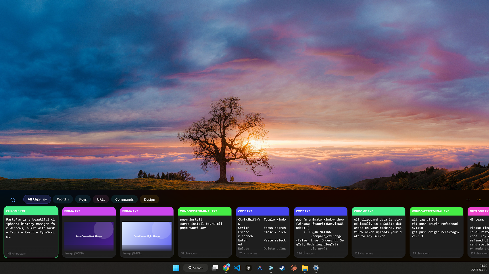

# PasteWin

A clipboard history manager for Windows. Press one hotkey, and everything you have copied shows up as a horizontal card stream — pick one and it pastes straight back into the window you came from.

> **Fork notice** — PasteWin is a GPL-3.0 fork of [XueshiQiao/PastePaw](https://github.com/XueshiQiao/PastePaw) (v1.6.0). Upstream author: XueshiQiao. Modifications in this repository are released under the same license. See [License](#license).



## Why this fork

Upstream is already a solid app (Tauri 2 + Rust + React + SQLite). Rather than building another clipboard manager from scratch, this fork keeps the good parts and closes the gaps that matter for daily use:

| Change | Status |
|---|---|
| Own app identity (`com.pastewin.app`), own data directory | done |
| Removed Aptabase telemetry (upstream reported to the author's account) | done |
| Removed upstream auto-update channel | done |
| Dropped macOS App Store build config | done |
| `Ctrl+1..9` to paste the Nth card directly | planned |
| File support (`CF_HDROP` — copying files in Explorer) | planned |
| FTS5 full-text search (upstream uses `LIKE '%q%'`, full table scan) | planned |
| Retention policy (max items / max days) | planned |
| `P` to pin (upstream binds the key but has no `is_pinned` column) | planned |

## Features

- Clipboard history for text, rich text (HTML/RTF), and images
- Horizontal card stream with source-app icon, preview, and character count
- Global hotkey (default `Ctrl+Shift+V`, customizable)
- Search across history (`Ctrl+F`)
- Folders to organize clips
- Application exceptions — never record from password managers or banking apps
- Multi-monitor aware — appears on the display where your cursor is
- Native dark/light theme with Mica window effects
- 100% local: SQLite database on your machine, nothing uploaded
- Optional AI actions (bring your own OpenAI-compatible API key)

## Install

Download the latest `PasteWin_<version>_x64-setup.exe` from [Releases](../../releases) and run it.

- Windows 10 1809+ / Windows 11, x64
- WebView2 is preinstalled on Windows 11; older Windows 10 may need the Evergreen Runtime
- The installer is unsigned, so SmartScreen warns on first run → *More info* → *Run anyway*

## Keyboard shortcuts

| Where | Keys | Action |
|---|---|---|
| Global | `Ctrl+Shift+V` | Show / hide the panel |
| In app | `←` `→` | Move selection |
| In app | `Enter` | Paste selected clip |
| In app | `Ctrl+F` | Focus search |
| In app | `Delete` | Delete selected clip |
| In app | `Esc` | Close panel / clear search |

Paste is sent as `Shift+Insert` rather than `Ctrl+V`, so it works in terminals (PowerShell, WSL, VS Code) where `Ctrl+V` inserts a control character.

## Build

```bash
pnpm install
pnpm tauri build          # needs Rust + MSVC toolchain on Windows
```

Windows installers are also built by GitHub Actions on every push to `main` — see [`.github/workflows/build.yml`](.github/workflows/build.yml). Artifacts appear on the Actions run page.

## Known limitations

- Cannot paste into elevated (administrator) windows — Windows UIPI blocks synthetic input across integrity levels
- Copying files in Explorer is not recorded yet
- Search degrades past ~10k items

## License

GPL-3.0. This project is a derivative work of [PastePaw](https://github.com/XueshiQiao/PastePaw) by XueshiQiao, licensed under GPL-3.0. All modifications are released under GPL-3.0 as well. Original copyright notices are preserved in the source files and in [LICENSE](LICENSE).

If you distribute a build of this project, you must make the corresponding source available under GPL-3.0.
