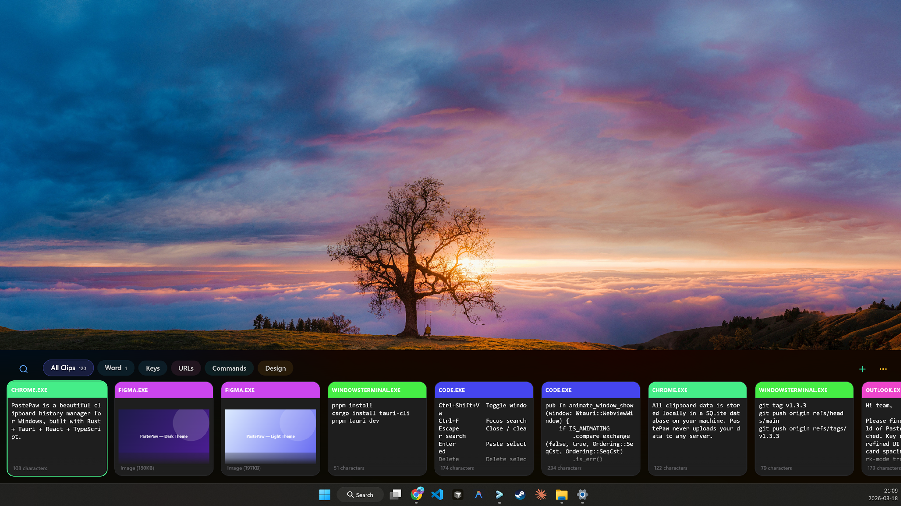

# PasteWin

Windows 剪贴板历史管理器。按一次热键，所有复制过的内容以横向卡片流铺开，选中一张就粘回原来的窗口。

> **Fork 说明** — 本项目是 [XueshiQiao/PastePaw](https://github.com/XueshiQiao/PastePaw)（v1.6.0）的 GPL-3.0 衍生版本。原作者：XueshiQiao。本仓库的修改同样以 GPL-3.0 发布，详见[许可证](#许可证)。



## 为什么要 fork

上游本身做得不错（Tauri 2 + Rust + React + SQLite），没必要从零再写一个。这个 fork 保留它的底子，只补日常使用真正缺的东西：

| 改动 | 状态 |
|---|---|
| 独立应用标识（`com.pastewin.app`）与独立数据目录 | 已完成 |
| 移除 Aptabase 遥测（上游会把数据上报到作者账号） | 已完成 |
| 移除上游自动更新通道 | 已完成 |
| 去掉 macOS App Store 构建配置 | 已完成 |
| `Ctrl+1..9` 直接粘贴第 N 张卡片 | 计划中 |
| 文件类型支持（`CF_HDROP`，资源管理器里复制文件） | 计划中 |
| FTS5 全文检索（上游用 `LIKE '%q%'` 全表扫） | 计划中 |
| 自动保留策略（按条数/天数清理） | 计划中 |
| `P` 键置顶（上游绑定了按键但没有 `is_pinned` 列） | 计划中 |

## 功能

- 文本、富文本（HTML/RTF）、图片的剪贴板历史
- 横向卡片流：来源应用图标、内容预览、字符数
- 全局热键（默认 `Ctrl+Shift+V`，可自定义）
- 搜索历史（`Ctrl+F`）
- 文件夹分组
- 卡片置顶（`P` 或右键菜单），置顶项始终排在最前
- 快捷键直选：`Ctrl+1` … `Ctrl+9` 直接粘贴第 N 张
- 应用排除：密码管理器、银行类应用不记录
- 多显示器：面板出现在鼠标所在屏幕
- 跟随系统的深/浅色主题 + Mica 窗口效果
- 纯本地：数据存本机 SQLite，不上传
- 可选 AI 动作（自带 OpenAI 兼容 API Key）

## 安装

到 [Releases](../../releases) 下载最新的 `PasteWin_<版本>_x64-setup.exe` 运行。

- Windows 10 1809+ / Windows 11，x64
- Win11 自带 WebView2；旧版 Win10 可能需要装 Evergreen Runtime
- 安装包未签名，首次运行 SmartScreen 会拦截：更多信息 → 仍要运行

## 快捷键

| 位置 | 按键 | 作用 |
|---|---|---|
| 全局 | `Ctrl+Shift+V` | 显示/隐藏面板 |
| 面板内 | `←` `→` | 切换选中卡片 |
| 面板内 | `Ctrl+1` … `Ctrl+9` | 直接粘贴第 N 张卡片 |
| 面板内 | `P` | 置顶 / 取消置顶选中项 |
| 面板内 | `Enter` | 粘贴选中项 |
| 面板内 | `Ctrl+F` | 聚焦搜索 |
| 面板内 | `Delete` | 删除选中项 |
| 面板内 | `Esc` | 关闭面板 / 清空搜索 |

粘贴用 `Shift+Insert` 而不是 `Ctrl+V`，这样在 PowerShell、WSL、VS Code 终端里也能正常粘贴（`Ctrl+V` 在这些终端会输入控制字符）。

## 构建

```bash
pnpm install
pnpm tauri build          # 需要 Windows + Rust + MSVC 工具链
```

GitHub Actions 会在每次 push 到 `main` 时构建 Windows 安装包，见 [`.github/workflows/build.yml`](.github/workflows/build.yml)，产物在 Actions 运行页的 Artifacts。

## 已知限制

- 粘不进「以管理员运行」的程序——Windows UIPI 阻止跨完整性级别的模拟输入
- 资源管理器里复制文件暂不记录
- 历史超过约 1 万条后搜索会变慢

## 许可证

GPL-3.0。本项目是 XueshiQiao 的 [PastePaw](https://github.com/XueshiQiao/PastePaw) 的衍生作品，上游同样以 GPL-3.0 授权。本项目所有修改也以 GPL-3.0 发布，原始版权声明保留在源文件与 [LICENSE](LICENSE) 中。

分发本项目的构建产物时，必须同时以 GPL-3.0 提供对应源码。
